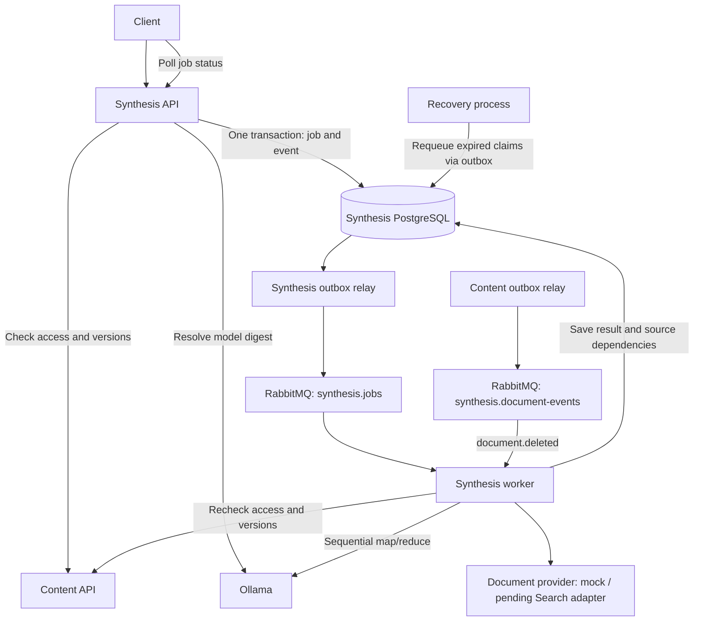

# StudyHub Synthesis Service

The Synthesis Service selects and combines original study excerpts from one or more documents. It exposes a FastAPI API, processes jobs asynchronously through RabbitMQ, stores jobs and results in its own PostgreSQL database, and uses Ollama for text generation. The model selects excerpt IDs; the server copies original passages and attaches their actual chunk citations. It does not publish model-authored factual prose or translations.

The service uses **on-demand generation with cached results**: it reuses a matching valid result or active job before creating new work. Document permissions and versions are checked with the Content & Metadata Service rather than trusted from the cache.

## Current implementation

Implemented features include asynchronous jobs, version-aware caching, concurrent request deduplication, a transactional outbox, bounded retries, worker lease recovery, hierarchical excerpt selection, source-bound citations, deletion-driven invalidation, and dependency/process readiness.

Two integration boundaries remain incomplete:

- **Search & Index:** the full-document provider interface exists, but the Search HTTP adapter is not implemented. `DOCUMENT_PROVIDER=search` fails closed, even with a configured URL and token.
- **Production identity:** summary routes currently support only development identities, `alice` and `bob`. Without explicit development mode, they return `503 Authentication is not configured`.

The runnable development path uses **real Content authorization and explicitly configured synthetic document text**. It does not extract text from uploaded files or establish integration with AI Processing or Search.

## Architecture



### Processes

All four Synthesis processes share one image and database but run separate entrypoints.

| Compose service | Entrypoint | Responsibility |
| --- | --- | --- |
| `synthesis-api` | `uvicorn app.main:app --host 0.0.0.0 --port 8000` | Initialize the schema, accept summary requests, and return job status/results. |
| `synthesis-worker` | `python -m app.messaging.consumer` | Consume summary jobs and document deletion events; generate and invalidate results. |
| `synthesis-outbox-relay` | `python -m app.messaging.outbox` | Publish due committed outbox events to `synthesis.jobs`, with persistent messages and publisher confirms. |
| `synthesis-recovery` | `python -m app.messaging.recovery` | Check expired running jobs every two seconds and retry or fail them. |

### Request lifecycle

1. The API validates the request and development `User_Name` header.
2. Content verifies access to every document and returns current versions. The API resolves the installed Ollama model digest and captures generation settings.
3. A cache key identifies the user, document versions, instruction, model revision, prompt, provider identity, and generation configuration. A matching valid completed result is reused; otherwise, a matching active job is reused.
4. For new work, the API inserts a `PENDING` job and `synthesis.requested` outbox event in one database transaction. The relay publishes after commit.
5. The worker claims the job, rechecks its configuration and live source versions, and retrieves complete, version-pinned chunks.
6. The server splits source text into bounded original excerpts (at most 512 characters each), removing identical passages within each document. Sequential selection reduces long inputs. Structured output requires selections for every supplied document and restricts IDs to that document. The server verifies selections and renders the unchanged passages with its own `[S1]` labels.
7. After generation, the worker rechecks configuration and access. It commits only while its claim is live and no source deletion tombstone blocks completion.
8. The client polls job status. Before returning completed text, the API checks source permissions and versions again.

### Reliability and consistency

- **At-least-once delivery:** publication can repeat after a crash between broker confirmation and database commit. Database claims and state checks prevent duplicate messages from independently committing the same job.
- **Bounded retries:** temporary dependency failures retry with exponential backoff, up to three total attempts. Permanent errors, such as stale versions, invalid citations/source data, and exhausted budgets, fail immediately.
- **Renewable claims:** a 45-second lease renews every 15 seconds. Claim tokens fence out stale workers; recovery retries expired jobs through the outbox.
- **Deletion handling:** Content publishes `document.deleted` through the `document.events` topic exchange. The worker consumes it from `synthesis.document-events`, records an idempotent tombstone, and marks dependent results `INVALIDATED`. Matching transaction advisory locks serialize deletion and completion to prevent late result insertion.
- **Live authorization:** mock mode and cached results still require Content checks. All input chunks remain source dependencies, including chunks not cited in the final text.

## Run locally with Docker Compose

Run the commands below from the **repository root**, where `compose.yaml` lives. The complete example uses PowerShell.

### 1. Prepare Docker and Ollama

You need Docker Desktop running its Linux container engine, the `docker compose` command, and Ollama running on the host. The container image uses Python 3.12 and installs the service requirements; host Python is only needed for optional offline checks.

Install the model configured by `AI_MODEL`:

```powershell
ollama pull llama3.2:1b
ollama list
```

If Ollama is not already serving requests, start `ollama serve` in another terminal. Its server must be reachable **from the containers** at `OLLAMA_BASE_URL`; a successful host connection alone does not verify container connectivity.

### 2. Create local configuration

```powershell
.\setup\setup-content-service.ps1
```

Despite its name, this existing script prepares the shared root `.env`, generates missing service tokens, and adds every missing setting from `.env.example`. It preserves existing values, including credentials. On macOS, use `bash setup/setup-content-service.sh` (requires `python3`).

Review root `.env` and explicitly set:

```dotenv
STUDYHUB_DEV_IDENTITY=1
DOCUMENT_PROVIDER=mock
OLLAMA_BASE_URL=http://host.docker.internal:11434
AI_MODEL=llama3.2:1b
MOCK_DOCUMENTS_FILE=/app/dev-fixtures/documents.json
```

Keep all three shared tokens nonempty: `STUDYHUB_PROCESSING_TOKEN`, `STUDYHUB_SEARCH_TOKEN`, and `STUDYHUB_SYNTHESIS_TOKEN`. The Compose configuration requires them for Content and supplies the same Synthesis token to both services.

Keep `.env` private and use URL-safe database/broker credentials because Compose interpolates them into connection URLs. Where `host.docker.internal` is unavailable, set an address reachable from containers.

### 3. Start Content and upload a development document

```powershell
docker compose up --build -d content-api content-relay
docker compose ps
```

These targets also start Content's database, migration process, and RabbitMQ. Wait for Content to become healthy, then open `http://127.0.0.1:8000/docs`.

Upload a small synthetic file with `POST /documents`, using `User_Name: alice`. Copy the returned `documentId`. Check `documentVersion` with `GET /documents/{document_id}`; new uploads start at version `1`.

The upload establishes ownership and version metadata. The next step supplies the actual text to summarize; the mock provider does not read the uploaded bytes.

### 4. Create and mount version-pinned mock text

The built-in `doc-601` and `doc-602` fixtures support offline checks. They are not Content UUIDs and cannot be used for this live API walkthrough.

The simplest first-time demo setup uploads two synthetic text files and writes matching UUID/version fixtures:

```powershell
# Host Python is needed only for these setup/verification scripts.
python -m pip install -r synthesis-service/requirements.txt
python synthesis-service/scripts/prepare_demo.py
```

The script prints the document IDs. It refuses to overwrite an existing fixture; reuse that file's IDs for subsequent demos. Before replacing fixtures, let active jobs finish. The committed Compose configuration already mounts `synthesis-service/dev-fixtures/` read-only into both API and worker; no override file is required.

For a manually uploaded document, create `synthesis-service/dev-fixtures/documents.json` keyed by its actual Content UUID:

```json
{
  "REPLACE-WITH-CONTENT-UUID": {
    "version": 1,
    "content": "Synthetic source text to summarize."
  }
}
```

Use `MOCK_DOCUMENTS_FILE=/app/dev-fixtures/documents.json`. A host Windows path is not a container path. Fixtures provide text only: Content still checks actual ownership and versions. Changing fixture content changes generation/cache identity, so queued jobs using the previous fixture are rejected.

### 5. Start the complete stack

```powershell
docker compose up --build -d
docker compose ps
Invoke-RestMethod http://127.0.0.1:8002/health
```

The API initializes its schema and migrations at startup. Compose waits for its health check before starting the worker, relay, and recovery process. A successful response is:

```json
{"status":"healthy","database":"connected"}
```

`/health` deliberately checks only the API/database, so startup does not depend on workers that have not started yet. Check `/ready` before submitting work:

```powershell
Invoke-RestMethod http://127.0.0.1:8002/ready | ConvertTo-Json -Depth 4
```

`/ready` returns 200 only when the database, authenticated Content access-check API, installed Ollama model metadata, mock provider, worker consumers, outbox relay and recovery process are available; otherwise it returns 503 with boolean checks. Worker consumers are inspected through RabbitMQ. Process heartbeats run every 10 seconds and expire after 45 seconds; relay/recovery failure detection can take that long. Search mode reports not ready until its adapter/readiness is implemented. Readiness does not run inference or prove model relevance/quality.

| Interface | Host address |
| --- | --- |
| Synthesis API / Swagger | `http://127.0.0.1:8002` / `http://127.0.0.1:8002/docs` |
| Synthesis OpenAPI | `http://127.0.0.1:8002/openapi.json` |
| Content API / Swagger | `http://127.0.0.1:8000` / `http://127.0.0.1:8000/docs` |
| RabbitMQ management | `http://127.0.0.1:15672` |
| Synthesis PostgreSQL | `127.0.0.1:5434` |

Inside Compose, Synthesis uses `synthesis-db:5432`, `rabbitmq:5672`, and `http://content-api:8000`. RabbitMQ management uses the configured broker credentials.

## API usage

Use the exact development header **`User_Name`**, including the underscore. Summary JSON fields use snake_case. The Content service bearer token is supplied internally; clients do not send it to the Synthesis routes.

### Create or reuse a summary

```powershell
$headers = @{ User_Name = 'alice' }
$body = @{
    document_ids = @($documentId)
    instruction = 'Summarize the main concepts with source citations.'
} | ConvertTo-Json

$job = Invoke-RestMethod -Method Post `
    -Uri http://127.0.0.1:8002/api/v1/summaries `
    -Headers $headers -ContentType 'application/json' -Body $body
$job
```

Requests accept 1–20 distinct, nonempty document IDs and an instruction of 1–2,000 characters. The default instruction is `Generate a combined summary`. IDs and instructions are trimmed; UUIDs are normalized before duplicate checks. For live Content access, use real uploaded UUIDs.

`POST /api/v1/summaries` returns `202 Accepted`, including for completed cache hits:

```json
{
  "job_id": "87654321-4321-4321-8321-123456789abc",
  "status": "PENDING",
  "cache_hit": false
}
```

A completed cache hit returns `status: "COMPLETED"` and `cache_hit: true`. Reusing an active job returns its current status and `cache_hit: false`. Ollama model metadata must be available even for a potential cache hit because the digest is part of cache identity.

### Poll status and read the result

```powershell
Invoke-RestMethod `
    -Uri "http://127.0.0.1:8002/api/v1/summaries/jobs/$($job.job_id)" `
    -Headers $headers | ConvertTo-Json -Depth 6
```

Repeat until `status` becomes `COMPLETED` or `FAILED`. The normal lifecycle is `PENDING → RUNNING → COMPLETED`. Transient failures can return a job to `PENDING`; terminal failures produce `FAILED`.

Illustrative completed response (actual IDs and text will differ):

```json
{
  "job_id": "87654321-4321-4321-8321-123456789abc",
  "status": "COMPLETED",
  "attempts": 1,
  "error_message": null,
  "summary_text": "> Microservices own their data. [S1]",
  "summary_status": "VALID",
  "citations": [
    {
      "source_id": "S1",
      "document_id": "00000000-0000-0000-0000-000000000001",
      "document_version": 1,
      "chunk_id": "00000000-0000-0000-0000-000000000001:1",
      "page": null,
      "source_location": "mock-fixture"
    }
  ]
}
```

Incomplete jobs return no summary text or citations. Result validity (`VALID` / `INVALIDATED`) is separate from job status: a job can remain `COMPLETED` after its result is invalidated. The endpoint refuses to serve invalidated or inaccessible summaries.

### Error responses

| Status | Meaning |
| --- | --- |
| `401` | Missing development `User_Name` header. |
| `403` | Unsupported development user, or a requested document is missing/inaccessible during creation. |
| `404` | Job missing/not owned by the caller, or completed sources are no longer accessible/current. |
| `409` | Completed result missing, invalidated, or lacking source metadata. |
| `422` | Invalid request body or job UUID. |
| `503` | Authentication unconfigured, database/Content/configuration unavailable, or a concurrent job-state change requiring a retry. |

Worker failures appear in the job's `status` and `error_message`. A `202` response does not guarantee successful generation.

## Configuration reference

See root [`.env.example`](../.env.example) for shared settings. Defaults below refer to the application unless marked as Compose defaults. Compose reads root `.env`; Python processes do not automatically load it.

| Setting | Default / source | Purpose |
| --- | --- | --- |
| `DATABASE_URL` | Required; constructed by Compose | Synthesis PostgreSQL connection URL. |
| `SYNTHESIS_DB`, `SYNTHESIS_DB_USER`, `SYNTHESIS_DB_PASSWORD` | Compose: `synthesis_db`, `synthesis`, `synthesis_dev` | Database container credentials and application URL construction. |
| `RABBITMQ_HOST` | `rabbitmq` | Broker hostname; application port is `5672`. |
| `RABBITMQ_USER`, `RABBITMQ_PASSWORD` | Required for messaging | Compose maps these from `RABBITMQ_DEFAULT_USER` / `RABBITMQ_DEFAULT_PASS`. |
| `CONTENT_SERVICE_URL` | `http://content-api:8000` | Live access/version verification base URL. |
| `STUDYHUB_SYNTHESIS_TOKEN` | Empty; must be configured | Bearer token accepted by Content. |
| `STUDYHUB_DEV_IDENTITY` | Disabled unless `1` | Enable `alice` / `bob`; also required for mock mode. |
| `DOCUMENT_PROVIDER` | `search`; example `.env` uses `mock` | Full-document provider; Search adapter is pending. |
| `MOCK_DOCUMENTS_FILE` | Application: empty; example: `/app/dev-fixtures/documents.json` | Fixture JSON path visible to API/worker; otherwise built-in fixtures are used. |
| `SEARCH_SERVICE_URL`, `STUDYHUB_SEARCH_TOKEN` | Empty | Needed to construct the Search client; do not enable the unfinished adapter. |
| `RETRIEVAL_VERSION` | `search-contract-pending-v1` | Retrieval identity included in generation settings/cache keys. |
| `OLLAMA_BASE_URL` | `http://host.docker.internal:11434` | Model server reachable from Synthesis processes. |
| `AI_MODEL` | `llama3.2:1b` | Installed tag; its digest is resolved through Ollama `/api/tags`. |
| `AI_CONTEXT_SIZE` | `4096` | Context size passed to Ollama. |
| `AI_OUTPUT_TOKENS` | `384` | Maximum generated tokens per inference call. |
| `AI_TEMPERATURE`, `AI_SEED` | `0.2`, `42` | Generation options included in configuration identity. |
| `AI_TIMEOUT_SECONDS` | `120` | Inference HTTP timeout. |
| `AI_MAX_CALLS` | `64` | Maximum inference calls per generation attempt. |
| `AI_MAX_SOURCE_BYTES` | `2000000` | Maximum total UTF-8 source text bytes. |
| `AI_MAX_JOB_SECONDS` | `900` | Execution deadline per worker claim; must be at least 45 seconds. |

Keep API and worker settings consistent. After changing `.env`, run `docker compose up -d` to recreate affected containers; `docker compose restart` does not apply changed environment values. Stop active workers before coordinated configuration/model upgrades and resubmit jobs with outdated snapshots.

Generation also has fixed limits of 10,000 input chunks, 10,000 distinct excerpts and eight reduction levels. Final selection keeps up to eight excerpts total (or at least one per document for more than eight documents); reductions keep one excerpt per represented document. Every requested document is represented, but every chunk need not appear in the final summary. Prompt fitting uses a conservative UTF-8 byte budget rather than a model-specific tokenizer. Over-budget inputs, selections that do not shrink, invalid IDs, omitted documents and output-limit termination fail explicitly instead of silently truncating. Selection limits apply to IDs; returned quote length is bounded separately by the source/excerpt limits. Calls run sequentially to limit memory pressure. A blocked read can take up to `AI_TIMEOUT_SECONDS` to unwind after cancellation/deadline detection.

Published passages are copied directly from the cited source, so the model cannot invent text or attach it to another document. This establishes provenance, not truth: source material can be wrong, excerpts can lack context, and the model can choose less relevant passages. Long unpunctuated passages can be split into fragments. The service does not promise free-form explanation, translation or an answer when the sources do not contain it. Avoid updating/retagging a model during active jobs: pre/post digest checks cannot make the separate model server transactional.

## Storage and migrations

Synthesis owns its database and does not read Content's database directly.

| Table | Stored data |
| --- | --- |
| `synthesis_jobs` | User, request, cache key, source/configuration snapshots, status, attempts, and lease ownership. |
| `synthesis_results` | Summary text, model/prompt version metadata, citations, and result validity. |
| `summary_sources` | Every input chunk's document/version identity and location, for authorization and invalidation. |
| `outbox_events` | Publication payloads, scheduled availability, and publication state. |
| `synthesis_deleted_documents` | Deletion tombstones preventing late completion for deleted sources. |

`app.database.init_db()` creates base tables and applies numbered SQL files in `migrations/` in filename order within one transaction. Current migrations are idempotent and run at API startup. Missing required snapshot, heartbeat or extractive-upgrade migrations stops startup. Startup uses a database advisory lock to serialize concurrent initializers.

Migration `0004` marks legacy pending/running jobs without source/configuration snapshots `FAILED` and invalidates results without those snapshots. Rows are retained; affected requests must be resubmitted. Migration `0005` adds process heartbeats. Migration `0006` retains but invalidates earlier prose results and fails incompatible active jobs; resubmit those requests. Prompt version `synthesis-extractive-v3` prevents reuse of earlier prose cache identities. Do not mix old workers with upgraded execution code.

The `synthesis-postgres-data` named volume persists Synthesis data. Stop the stack while retaining volumes with:

```powershell
docker compose down
```

Do not add `-v` unless you intend to delete the stack's named database and broker volumes.

## Verification and troubleshooting

Follow Synthesis logs:

```powershell
docker compose logs -f synthesis-api synthesis-worker synthesis-outbox-relay synthesis-recovery
```

| Symptom | Check |
| --- | --- |
| Creation returns `503` | Development identity enabled; Content reachable; matching Synthesis token; Ollama reachable/model installed; fixture readable and settings valid. |
| Creation returns `403` | Every UUID is active and owned by the selected Content user. |
| Job remains `PENDING` | Relay/worker running, broker reachable, outbox publication logs, and `synthesis.jobs` queue. A retry may be waiting for its scheduled time. |
| Provider failure | Explicit mock mode, fixture mounted in API and worker, matching Content UUID/version. Search mode is not functional yet. |
| Failure after configuration changes | Restore consistent settings or resubmit; jobs retain their original configuration. |
| Budget/citation failure | Inspect `error_message`; use smaller source inputs or review model/settings. Output must obey the source-label contract. |
| Result becomes inaccessible | Source deletion/version/access change or result invalidation; inspect Content and worker logs. |

For a manual acceptance check, create a summary, poll to completion, then submit the identical request and confirm the same job returns with `cache_hit: true`. Delete its source through Content and confirm the completed text can no longer be retrieved. Depending on event timing, retrieval returns `404` from the live access check or `409` after invalidation. Check worker logs for the deletion event.

Unit tests live in `tests/test_*.py` and use `unittest.TestCase` / `unittest.mock`, following AI Processing's approach. They are also automatically collected by pytest. No Docker, PostgreSQL, RabbitMQ, Content or Ollama process is needed: HTTP, database and broker boundaries are mocked. Test helpers reject accidental real HTTP/database/broker connections, and each case restores environment overrides and mocks.

From the repository root, install development dependencies and run pytest:

```powershell
python -m pip install -r synthesis-service/requirements-dev.txt
python -m pytest synthesis-service/tests -v
```

Or use the standard-library runner with only the normal runtime dependencies installed:

```powershell
python -m unittest discover -s synthesis-service/tests -t synthesis-service -v
```

From `synthesis-service/`, the equivalent command is `python -m unittest discover -s tests -v`.

The tests cover request validation and API error responses; user-scoped job retrieval and access rechecks; provider completeness and invalid metadata; original excerpts and source ownership; model versions, structured output and budgets; cache identity; job claims, leases, cancellation, retries and stale-result fencing; outbox publication, recovery and deletion acknowledgements; readiness; database initialization; and setup-script credential preservation/idempotence. Database mocks verify application decisions and transaction boundaries; actual PostgreSQL locking, SQL constraints and broker delivery remain the separate acceptance suite's responsibility.

Run the real local acceptance suite separately:

```powershell
python synthesis-service/scripts/acceptance.py
```

Run it only on an idle development stack with `DOCUMENT_PROVIDER=mock`, `STUDYHUB_DEV_IDENTITY=1`, and the fixture path above. It uploads synthetic documents, replaces the local demo fixture, creates test jobs, changes/deletes only its own test documents, temporarily stops Content/RabbitMQ/worker/relay/recovery, and kills one worker to verify real lease recovery. It restores those services in `finally`. Do not run it on a shared or production stack. Synthetic rows/files remain as evidence and demo material; no existing database volumes are removed.

Results, a usable demo job ID and document IDs are written to the Git-ignored local file `acceptance-results.json`. The suite uses real PostgreSQL, RabbitMQ, Content and Ollama. It checks concurrent deduplication, grounded short/long excerpts, cache, duplicate delivery, deletion invalidation, queued version/configuration changes, delayed retry, permanent errors, retry exhaustion, worker crash recovery and dependency outages. Retry classification is injected through the real job functions/DB; it is not a simulated Ollama server outage.

## Source layout

| Path | Purpose |
| --- | --- |
| `app/main.py` | FastAPI app, startup initialization, root, `/health` and `/ready` routes. |
| `app/database.py` | PostgreSQL connections and schema initialization. |
| `app/schemas.py` | Request, job response, and citation schemas. |
| `app/routes/summaries.py` | Development identity, live verification, cache/deduplication, transactional job creation. |
| `app/routes/jobs.py` | User-scoped job lookup and authorization before returning results. |
| `app/services/job_execution.py` | Claims/leases, snapshot checks, retries, fenced completion. |
| `app/services/ai_client.py` | Ollama configuration/digest checks and bounded source-bound excerpt selection. |
| `app/services/document_provider.py` | Complete version-pinned chunk contract, mock provider, pending Search adapter. |
| `app/services/content_client.py` | Content access-check HTTP client. |
| `app/services/cache.py`, `citations.py`, `errors.py`, `mock_documents.py` | Cache identity, citation checks, error categories, fixtures. |
| `app/messaging/` | RabbitMQ consumer, outbox publisher, expired-job recovery. |
| `migrations/` | Numbered Synthesis schema changes. |
| `app/services/readiness.py` | Dependency checks and worker/relay/recovery heartbeats. |
| `tests/test_*.py`, `requirements-dev.txt`, `pytest.ini` | Offline unittest suite, pytest collection and test dependencies. |
| `scripts/prepare_demo.py`, `scripts/acceptance.py` | Synthetic fixture setup and real local acceptance tests. |
| `Dockerfile`, `requirements.txt` | Shared image and runtime dependencies. |
